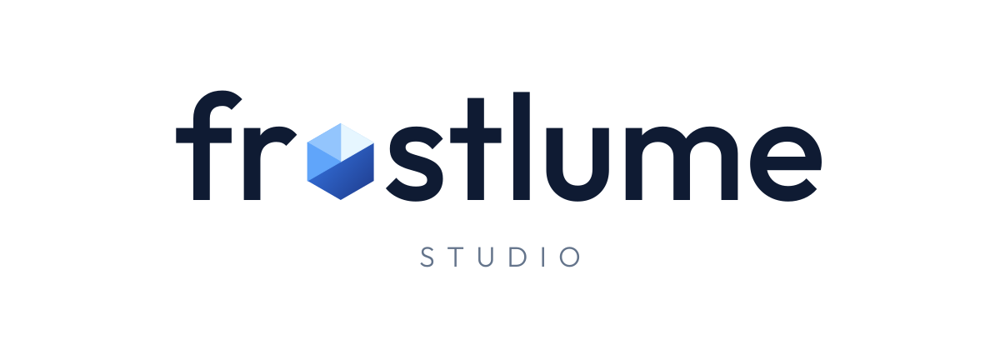
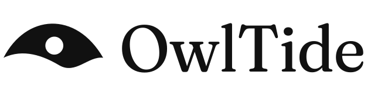

# brand

Frostlume 及旗下产品的 Logo、图标与使用规范。

  
  &nbsp;&nbsp;&nbsp;
  

## 目录

| 目录 | 内容 |
| --- | --- |
| `frostlume/color/` | 工作室彩色标：字标（浅底 / 深底 / 透明底）、六边形标、应用图标 |
| `frostlume/mono/` | 单色版：黑、白字标，单色图标与单色标 |
| `frostlume/banner/` | 横幅：透明底、紧凑裁切，浅色 / 深色两版，用于 README 和主页头图 |
| `frostlume/motion/` | Logo 动画：入场、循环待机、退场。`frostlume-anim.html` 是源文件（纯 SVG + Web Animations API，无外部依赖），另有浅色 / 深色 MP4 录屏（1280×720，约 13 秒） |
| `frostlume/avatar/` | 头像用的方形图（GitHub 组织头像等），1024×1024 |
| `floe/` | 霁 Floe 浏览器图标（药丸·切口）：浅色、深色、单色主题图标、满版、自适应前景层，SVG + 512 PNG |
| `owltide/` | OwlTide 的潮汐眼图标、标志与字标（浅色 / 深色） |

SVG 是源文件，PNG 由 SVG 导出。需要别的尺寸时请从 SVG 导出，不要放大 PNG。

## Frostlume

### 颜色

| 用途 | 色值 |
| --- | --- |
| 深底（海军蓝） | `#0F1B33` |
| 主渐变 | `#3B82F6` → `#1E3A8A` |
| 亮面 | `#E6F6FF` |
| 次亮面 | `#93C5FD` |
| 侧面 | `#60A5FA` |

### 字体

- 字标：Outfit（Google Fonts，SIL OFL 1.1），`frostlume` 小写，字重 500；`STUDIO` 字重 300，加宽字距
- 字标中的 `o` 由六边形冰晶代替；SVG 内文字已转为路径，使用时不需要安装字体

### 用法

- 彩色标优先；只能用一种颜色时，用完整字标的单色版（`mono/`），不要单独使用单色六边形
- 四周至少留出六边形高度一半的空白
- 不要拉伸、旋转、改色、加描边或阴影，不要拆开六边形的三个亮面
- 动画只用 `motion/` 里的版本，不要自己另做入场效果
- 浅色背景用 `frostlume-light`，深色背景用 `frostlume-dark`

## OwlTide

- 图标：潮汐眼（下眼睑是一道波浪，中间是瞳孔）
- 字标：Fraunces（Google Fonts，SIL OFL 1.1），已转为路径
- 颜色：浅底 `#111111`，深底 `#F0F6FC`；瞳孔为透明镂空

## 许可

本仓库内的 Logo、图标和字标是 Frostlume 的标识，**保留所有权利**，不适用各产品代码仓库的开源许可证。

- 可以：在介绍、报道、链接到我们的项目时原样使用
- 不可以：修改后使用，用于你自己的产品或服务，或暗示与我们有合作或背书关系

如需其他用途，请联系 wanjiestudio@163.com。
